<div align="center">

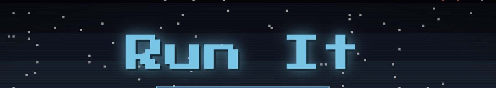

🌐 [Español](README.md) · **English**

### Knockout competitive programming tournaments, with a live race track

Every participant is a runner. Every test they pass brings them closer to the finish line.<br>
Every round knocks out those who don't make it. **Last one standing wins.**


[How it works](#-how-it-works) ·
[Organizer](#-organizer-panel) ·
[Participant](#-participant-screen) ·
[Track and audience](#-the-track-and-the-audience-screen) ·
[Audience vote](#-audience-vote-hits) ·
[Ceremony](#-awards-ceremony) ·
[Architecture](#-architecture) ·
[Development](#-development)

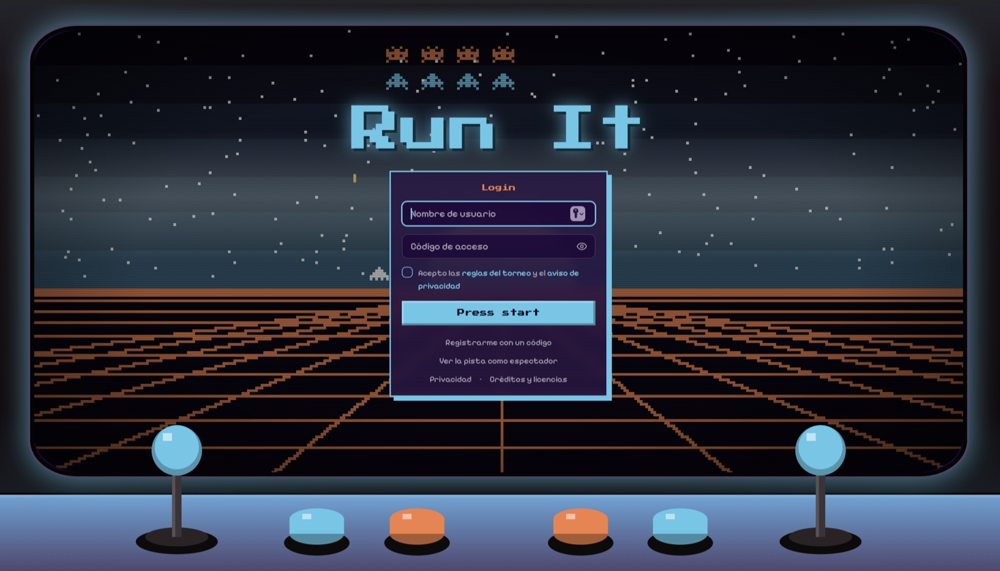

</div>

> The app's interface is in Spanish; the screenshots show it as players see it.

---

## 🏁 How it works

Run It turns a programming tournament into a race you can project in a room. The
organizer sets up the rounds, participants solve problems, and the audience
watches the runners move along the track.

```text
  Round 1            Round 2            Round 3            Final
  ┌────────┐         ┌────────┐         ┌────────┐         ┌────────┐
  │ 16 🐎  │  ─────▶ │  8 🐎  │  ─────▶ │  4 🐎  │  ─────▶ │  1 🏆  │
  │ cap 8  │         │ cap 4  │         │ cap 1  │         │        │
  └────────┘         └────────┘         └────────┘         └────────┘
```

1. **Each round has one problem, a qualifier cap and a time limit.** The round
   closes when the cap fills up or when the clock runs out.
2. **The first to solve** every test case qualify. Everyone else is knocked out.
3. **Qualifiers move on to the next round automatically.** Nobody from outside
   can join mid-tournament.
4. **The round that leaves a single qualifier is the final.** That runner wins
   the tournament and the awards ceremony begins.

### Ranking order

Ties are broken in this order:

| # | Criterion | Detail |
| --- | --- | --- |
| 1 | **Completed** | Whoever passed every case ranks above whoever didn't. |
| 2 | **Arrival** | Among those who completed, whoever finished first. |
| 3 | **Tests** | Among those who didn't complete, the higher share of cases passed. |
| 4 | **Penalties** | Each failed submission adds a **30 s** penalty. |

### Languages

| Language | Compiler in Judge0 |
| --- | --- |
| C | GCC 9.2.0 |
| C++ | GCC 9.2.0 |
| Python | Python 3 |

The starter templates for each language live in
[`plantillas_lenguajes/`](plantillas_lenguajes/).

---

## 🛠 Organizer panel

The whole tournament is run from `/admin`, organized in tabs.

### Round control (*Control de ronda*)

The live dashboard for the current round: cap, connected players, how many
solved it, submissions, the clock and the Judge0 evaluation queue. From here the
organizer starts the round (with a 10 s countdown), pauses it or forces it to
close. On the right, **Tournament progress** lists every round, which one can be
started and why the others can't.

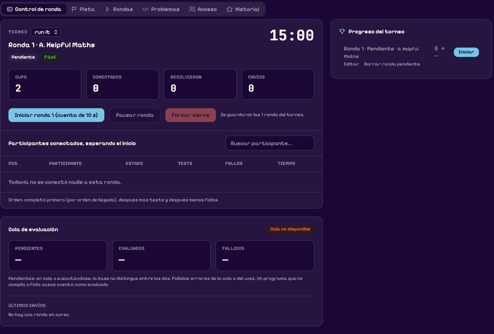

### Rounds (*Rondas*)

Create the tournament and plan all of its rounds at once: difficulty, problem,
qualifier cap and time. Pending rounds can be edited until they start; each one
is filled automatically with the qualifiers of the previous round.

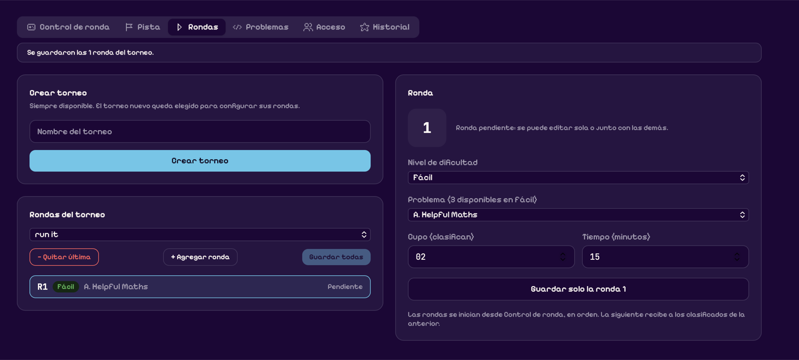

### Problems (*Problemas*)

Each problem has a statement (with KaTeX formula support), a difficulty and test
cases. Cases can be entered by hand or imported from a `.zip`. Cases marked as a
**public example** are shown to participants; the rest stay hidden. The
**organizer's hint** is only revealed if the audience wins it in a vote.

> Test cases can't change while a running round uses the problem. The name,
> statement and difficulty can.

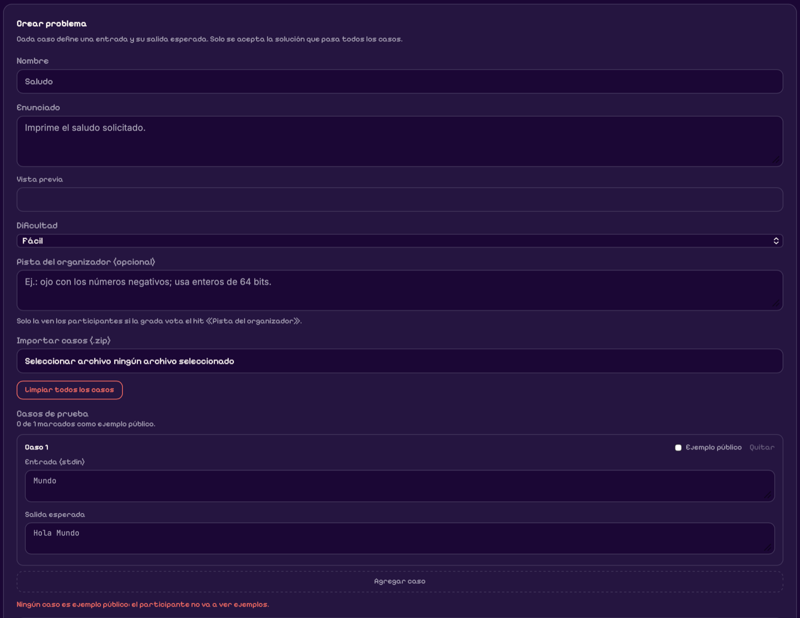

### Access (*Acceso*)

Participants sign up with a single-use **access code**. The organizer generates
them in batches, with an expiry and, optionally, tied to a tournament: when the
tournament ends, its codes are invalidated. More detail in
[`CODIGOS_ACCESO.md`](CODIGOS_ACCESO.md).

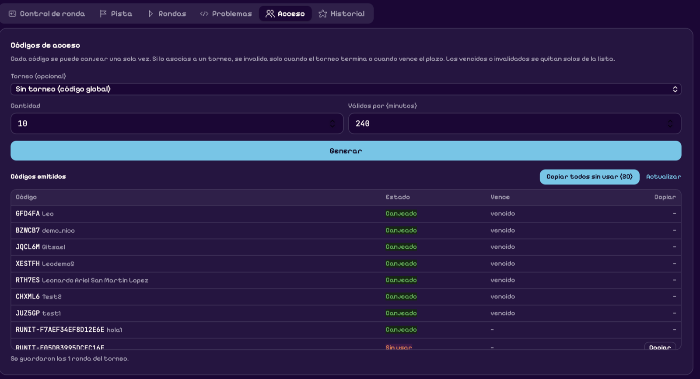

### History (*Historial*)

Finished tournaments drop out of the selectors and stay here until deleted. It
also lets the organizer clean up users who signed up and never joined a
tournament.

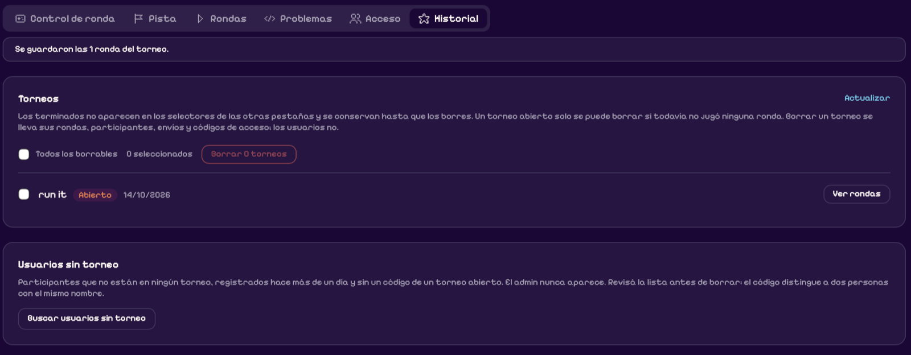

---

## 🎮 Participant screen

### 1. Pick a runner

Before the first round, each participant picks a character from several families
(classics, animals, Tiny Heroes, villagers, humans, NPCs). It's their horse on
the track for the whole tournament and can't be changed.

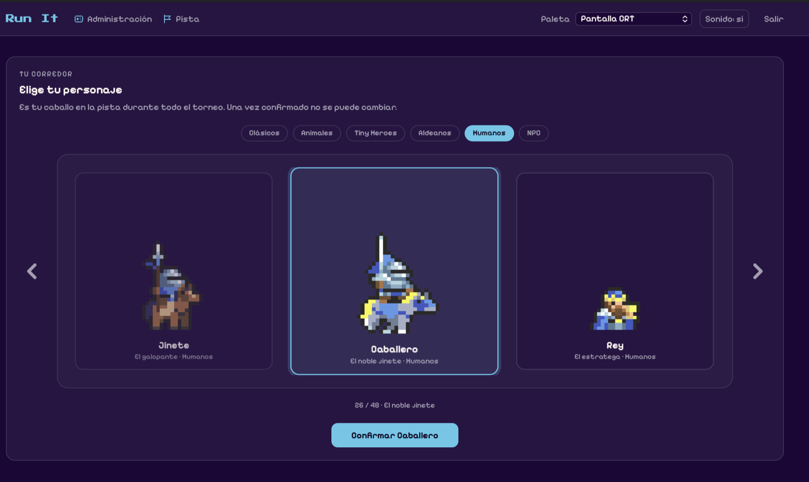

### 2. Waiting room and countdown

Until the organizer starts the round, the participant waits at the starting
line. Once it starts, a countdown warns that the editor is about to open.

<table>
  <tr>
    <td width="50%">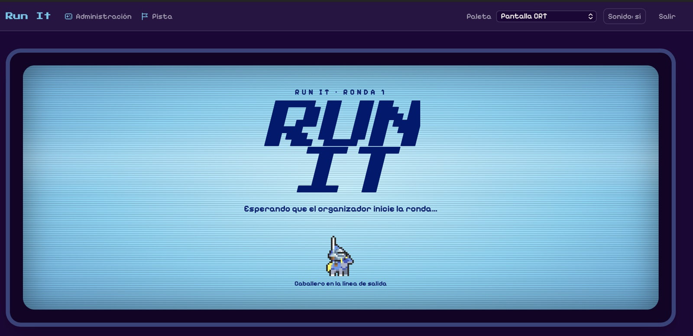</td>
    <td width="50%">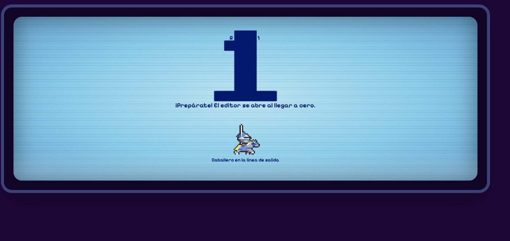</td>
  </tr>
  <tr>
    <td align="center"><sub>Waiting for the organizer to start the round</sub></td>
    <td align="center"><sub>Get ready! The editor opens when it hits zero</sub></td>
  </tr>
</table>

### 3. Solve

Statement on the left, editor with a starter template on the right, clock on
top. Below, the public examples and the submission history.

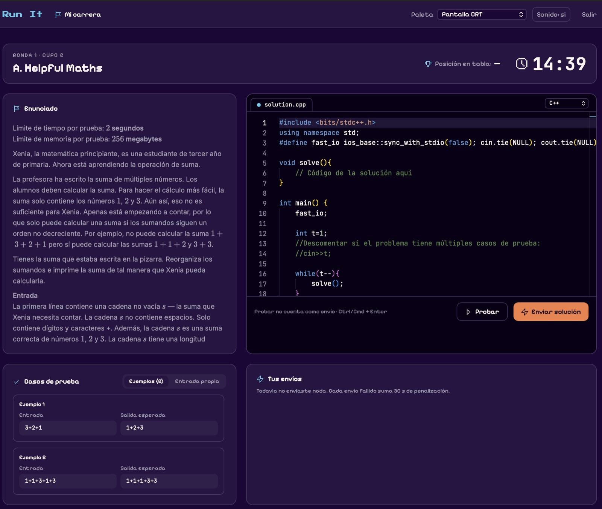

**Probar** (Test) runs the code against the examples (or a custom input) and
**doesn't count as a submission**. **Enviar solución** (Submit) evaluates it
against every case, visible and hidden.

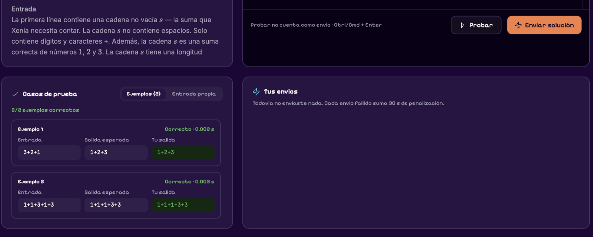

### 4. Qualify

Once every case passes, the spot is locked in and the editor is disabled: no need
to submit again that round.

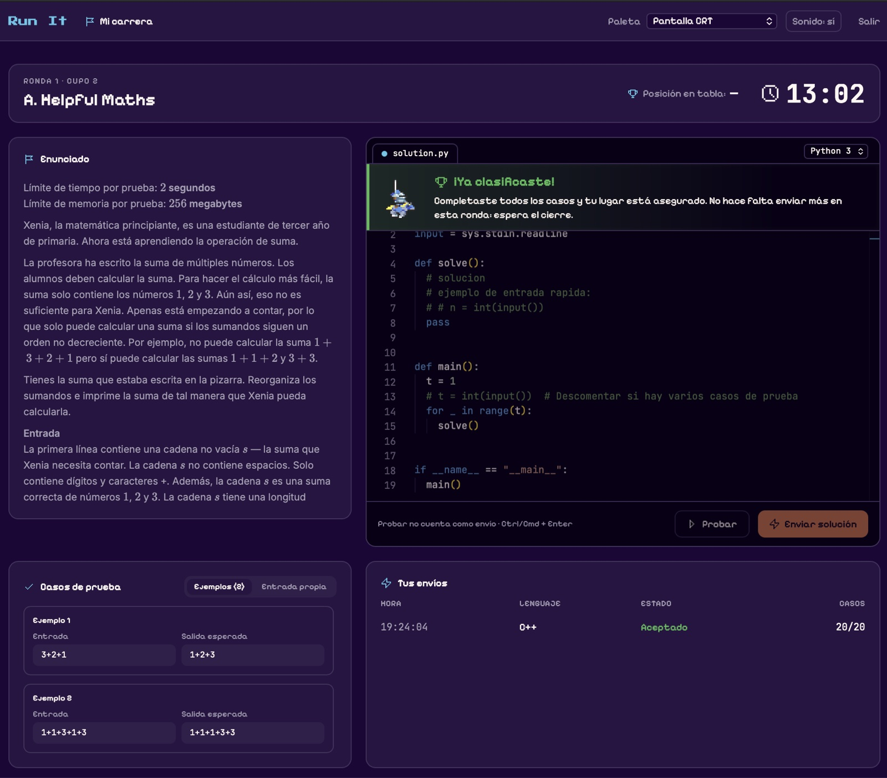

---

## 📺 The track and the audience screen

### `/pista` — the race

Built to be projected. Each runner advances by the percentage of tests solved;
qualified runners are marked in green, and the side panel tracks the cap and
narrates what happens live.

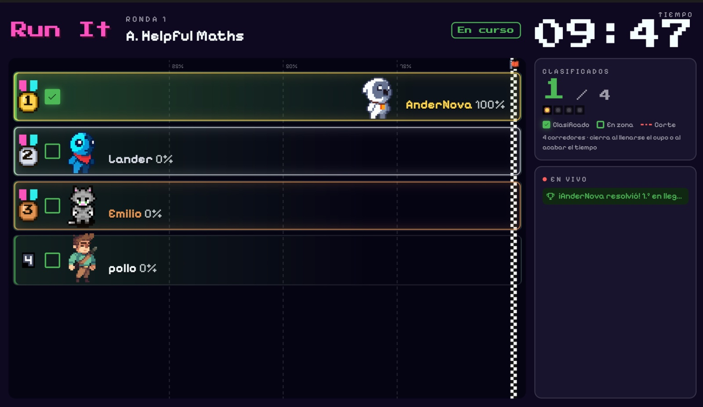

<table>
  <tr>
    <td width="50%">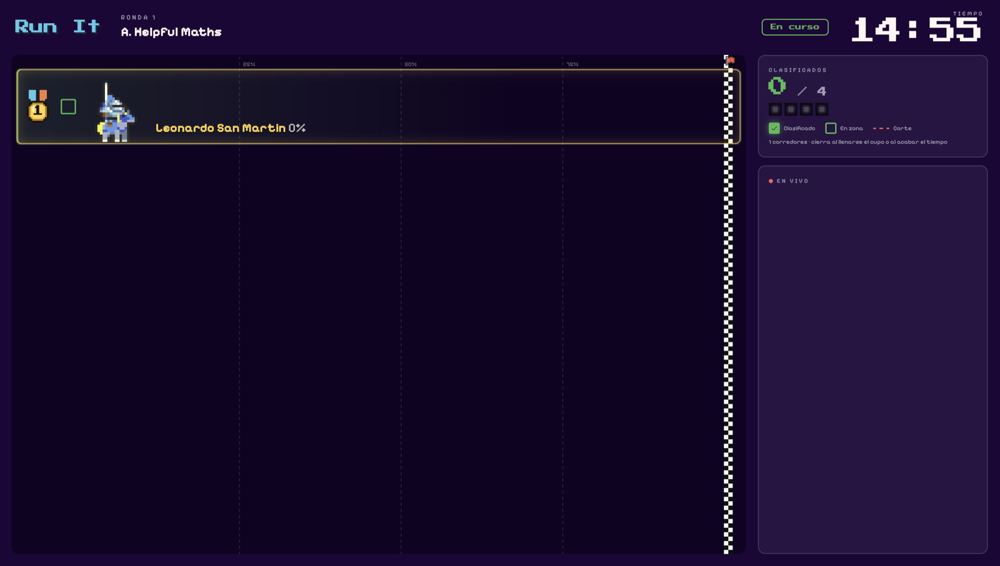</td>
    <td width="50%">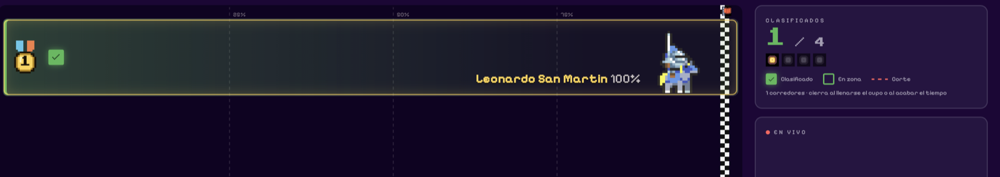</td>
  </tr>
  <tr>
    <td align="center"><sub>Starting line, 0%</sub></td>
    <td align="center"><sub>At the finish, 100% and qualified</sub></td>
  </tr>
</table>

### `/publico` — themed scenes

Another way to show the same round, with switchable scenes: **The track**,
**The lava tower**, **Balloons to the sky**, **Football: the goal** and
**The lifeboat**. In *Balloons to the sky*, each block of tests lifts the balloon
one level, and those who reach the golden cloud are the ones who qualify.

<table>
  <tr>
    <td width="50%">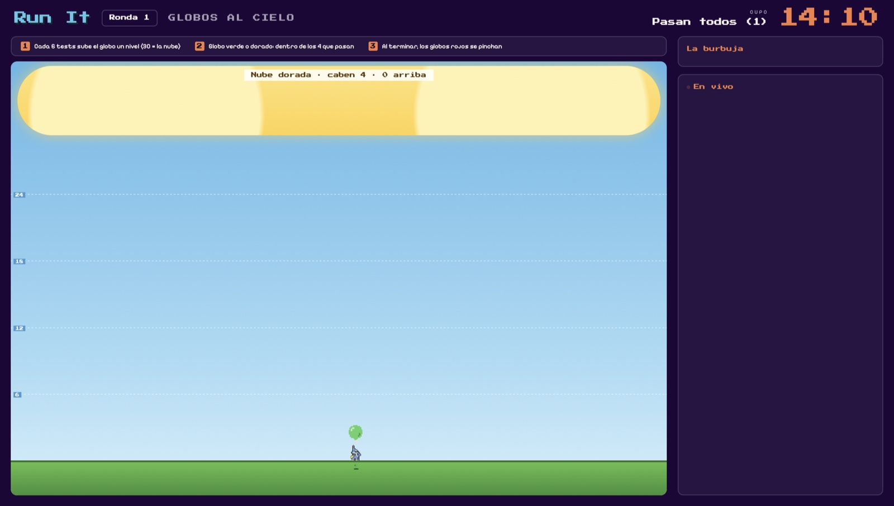</td>
    <td width="50%">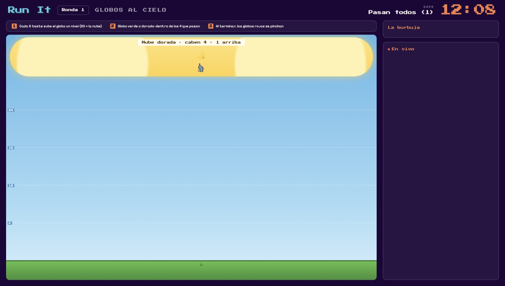</td>
  </tr>
  <tr>
    <td align="center"><sub>The balloon takes off</sub></td>
    <td align="center"><sub>Reached the golden cloud: qualified</sub></td>
  </tr>
</table>

Both screens show a QR code so the audience can vote at `/votar`.

---

## 🗳 Audience vote (hits)

While a round is running, the organizer announces a vote: the audience scans the
QR code and, without an account, picks between a **good hit** and a **bad hit**
of the same weight. There's a 15 s heads-up and 40 s to vote. The effect hits
every runner equally and **never touches the editor, the statement or the
verdict**.

| Weight | Good hit 🟢 | Bad hit 🔴 |
| :---: | --- | --- |
| 1 | **Organizer's hint**: the problem's hint is revealed | **Hidden clock**: the clock disappears for 60 s |
| 1 | **Crowd cheer**: encouragement on screen | **Blackout**: screens go dark for 45 s |
| 2 | **Extra minute**: +60 s for the round | **Fog**: the ranking is hidden for 75 s |
| 2 | **Amnesty**: failures carry no penalty for 90 s | **Double penalty**: each failure costs double for 120 s |
| 3 | **Cap +1**: one more qualifies | **Cap −1**: one fewer qualifies |

Rules: at most 2 votes per round, none in the first minute or the last 2, and
each pair can be used only once. Logged-in users can't vote.

---

## 🏆 Awards ceremony

When a single qualifier is left, the tournament ends. The ceremony is shown on
the track and on every participant's screen, and the organizer advances it step
by step from *Tournament progress*.

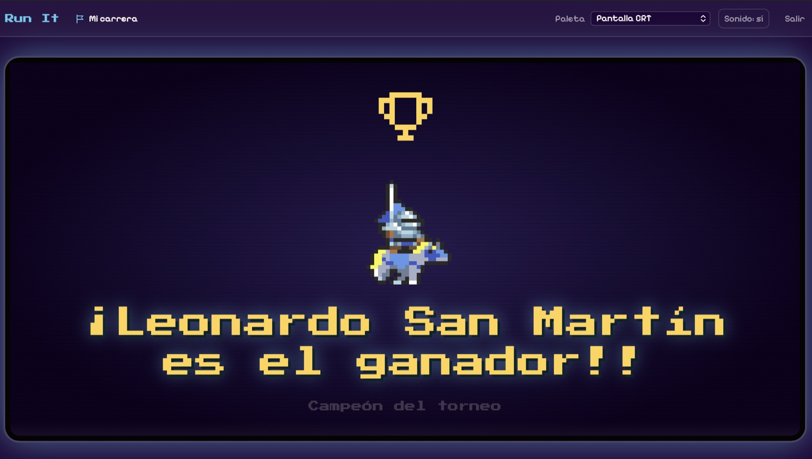

After the winner, the awards are revealed one by one. An award with no candidate
is left vacant.

| Award | Goes to |
| --- | --- |
| 🔥 **El Ave Fénix** (The Phoenix) | Qualified while on the edge of elimination. |
| 🗡 **El Matagigantes** (The Giant Slayer) | The breakout player who knocked out a favorite. |
| 🛡 **Superviviente** (Survivor) | Qualified without solving, on a tiebreak. |
| ⚔️ **El Verdugo** (The Executioner) | Most rounds won by being first to solve. |
| ⚡ **El Rayo del AC** (AC Lightning) | The first *Accepted* of the tournament. |
| 🚀 **Compilador O(1) Humano** (Human O(1) Compiler) | The fastest solution on the judge. |
| 💪 **Amigo del Penalizador** (The Penalty's Friend) | Most failed submissions on a single problem, without giving up. |
| 👑 **GMA · Gran Maestro del Algoritmo** (Algorithm Grandmaster) | The tournament winner. |

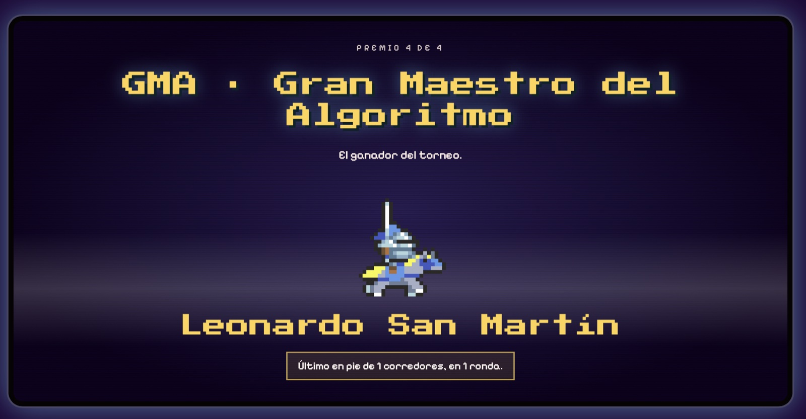

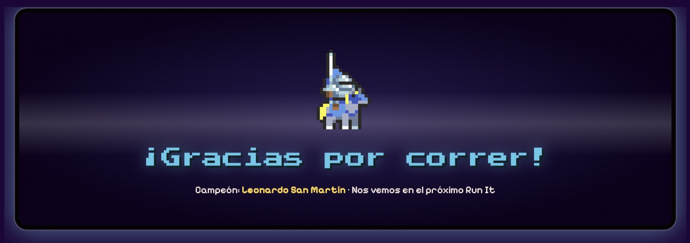

---

## 🎨 Palettes and sound

Each user picks a palette from the top bar, saved in their browser: **Arcade
Neón**, **Atardecer Synthwave**, **Ficha Dorada** and **Pantalla CRT**. Sound
effects (ZzFX) can be muted from the same place.

---

## 🧱 Architecture

```text
Internet
  │
  ├──▶ nginx :80/:443  (TLS Let's Encrypt)
  │       ├──▶ frontend  TanStack Start   :3002
  │       └──▶ backend   Fastify + Socket.io :3001
  │                ├──▶ PostgreSQL :5433   (run_it database)
  │                ├──▶ Redis      :6380   (sessions + BullMQ queue)
  │                └──▶ Judge0     :2358   (execution sandbox)
  │
  └──▶ Tailscale Funnel ──▶ 127.0.0.1:8080 ──▶ nginx
```

**Life of a submission:** the participant submits → the backend queues it in
BullMQ → the worker sends it to Judge0 case by case → the result comes back over
Socket.io to the participant's screen, the track and the panel.

| Layer | Technology |
| --- | --- |
| Frontend | Vite 8 · TanStack Start · React 19 · Tailwind CSS 4 |
| SSR | Nitro (`node-server`) |
| Backend | Fastify 5 · Socket.io · BullMQ |
| Data | PostgreSQL 16 · Redis 7 |
| Judge | Judge0 1.13 (Docker, `linux/amd64`, `privileged`) |
| Publishing | nginx · Tailscale Funnel |

### Repository layout

```text
frontend/              TanStack Start app
  src/routes/          login, admin, participante, pista, publico, votar, reglas, legal
  src/components/      AdminPanel, ProjectedRace, ParticipantView, publico/
run-it-backend/        Fastify + Socket.io API
  index.js             Routes, auth, rounds, scoring and sockets
  hits.js              Audience vote rules
  awards.js            Ceremony awards
  queue.js             BullMQ queue to Judge0
  schema.sql           Idempotent schema, applied on every start
deploy/                Dev, deploy, backup, smoke and e2e scripts
plantillas_lenguajes/  Starter templates for C, C++ and Python
docs/screens/          Screenshots for this README
```

---

## 💻 Development

Requires **Node.js 22.12 or later** and Docker. Judge0 needs an `x86_64` host:
on Apple Silicon the sandbox can't run code.

```bash
# Once per machine
sudo docker compose -p runit-dev -f docker-compose.dev.yml up -d
deploy/dev-branch.sh bootstrap-db

# Every session
deploy/dev-branch.sh up        # backend :5000 + frontend :4000 with HMR
deploy/dev-branch.sh restart   # after checkout, pull or merge
deploy/dev-branch.sh down
```

Checks before committing:

```bash
cd frontend && npm run typecheck && npm run lint
cd ../run-it-backend && npm test
```

### Tournament flow through the API

```text
POST /tournaments                  create a tournament
PUT  /tournaments/:id/plan         plan the rounds
POST /access-codes/generate        generate access codes
POST /auth/register                sign up with a code
POST /rounds/:id/participants/join join the first round
POST /rounds/:id/start             start the round
POST /rounds/:id/close             close it (or it closes itself on time)
POST /rounds/:id/next              move qualifiers to the next round
```

---

## 🤝 Contributing and license

Run It is **all rights reserved**. The code is public so it can be read and
improved: you may fork it **only to propose changes to this repository**.
Copying, reusing or redistributing it requires written permission from WeWolfDev.

- How to contribute and what opening a PR implies: [`CONTRIBUTING.md`](CONTRIBUTING.md)
- Full terms: [`LICENSE`](LICENSE)
- Third-party assets (sprites, backgrounds, fonts, sound) have their own
  licenses: [`CREDITS.md`](CREDITS.md)

---

## 📚 Documentation

The reference documents are in Spanish.

| Document | Contents |
| --- | --- |
| [`BACKEND_RUN_IT.md`](BACKEND_RUN_IT.md) | API, environment variables and sign-up flow |
| [`DEVELOPMENT_COMMANDS.md`](DEVELOPMENT_COMMANDS.md) | Development environment and SSH tunnel |
| [`MIGRACION_SERVIDOR_RUN_IT.md`](MIGRACION_SERVIDOR_RUN_IT.md) | Production deploy, rollback and diagnostics |
| [`CODIGOS_ACCESO.md`](CODIGOS_ACCESO.md) | Access codes and their states |
| [`LOCAL_CHANGES_CONFIG.md`](LOCAL_CHANGES_CONFIG.md) | Isolation between development and production |
| [`CHANGELOG_RUN_IT.md`](CHANGELOG_RUN_IT.md) | Log and known issues |
| [`CREDITS.md`](CREDITS.md) | Credits and licenses for sprites, backgrounds, fonts and sound |

---

<div align="center">

**Run It** · Made by WeWolfDev<br>
<sub>Leonardo San Martin Lopez · Cesar Augusto</sub><br>
<sub>Third-party sprites, backgrounds and fonts: see <a href="CREDITS.md">CREDITS.md</a></sub>

</div>
